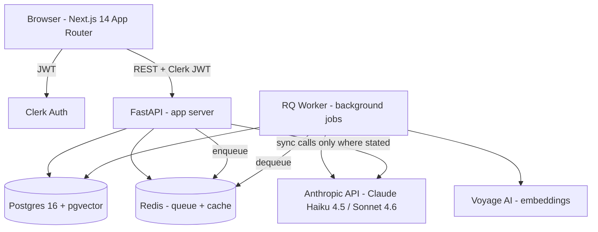

# JEE Prep Intelligence Platform — Design Document

> Version 1.0 · Implementation-ready · Intended reader: Claude (AI coding assistant)
> No TBDs, no placeholders. If it isn't in this doc, it isn't in the build.

---

## 1. Executive Summary

**JEE Prep Intelligence Platform** (internal name: `jpi`) is a web application that turns the daily/weekly test data a Narayana-style JEE coaching college already collects into three things: (a) a personalized practice queue for every student, seeded from their own mistakes; (b) a data-driven teacher console that says "these students need this, this topic needs reteaching"; and (c) a natural-language console for management that answers "how are we doing?" without a BI analyst in the loop.

The MVP covers seven features (F1–F7) across three roles (Student, Teacher, Management). It ingests test results via CSV upload or manual entry, uses a fixed JEE-aligned taxonomy to categorize mistakes, and uses Anthropic Claude in five scoped ways: mistake categorization (Haiku), similar-question re-ranking (Haiku), homework generation (Sonnet), question-paper generation with a hard 70/30 bank/LLM split (Sonnet), and text-to-SQL NLQ with a read-only whitelisted schema (Sonnet). Embedding retrieval uses pgvector on a pre-indexed curated question bank.

**MVP scope:** F1–F7 as specified, web-only, single Indian region, English UI, one coaching college as tenant, manual taxonomy seeded from this doc.

**Non-goals:** mobile native apps, parent portal, payments/fees, video lectures, proctoring, live classes, multi-tenant SaaS isolation beyond row-level, Hindi/regional UI, OMR scanning, PDF-to-question ingestion.

---

## 2. Personas & Jobs-to-be-Done

### 2.1 Aarav — Student (Class 12, targeting JEE Advanced)

| # | JTBD | Feature |
|---|---|---|
| S1 | "When I get a DPT question wrong, I want 2–3 similar questions in front of me *today* so the wrong pattern doesn't calcify." | **F1** |
| S2 | "I want to see which subtopics I keep failing at, not just a raw score." | F2 (read-only, self-view) |
| S3 | "When my teacher assigns me remedial work, I want it in the same practice queue, not a separate app." | **F4** (consumer side) |
| S4 | "When class homework drops, I want to attempt it in the same place." | **F5** (consumer side) |
| S5 | "I want to see solutions *after* I attempt, not before." | Practice Queue UX |

### 2.2 Priya — Teacher (owns 2 batches, teaches Chemistry)

| # | JTBD | Feature |
|---|---|---|
| T1 | "Before Monday's class I want to know which student is struggling with what, from last week's tests." | **F2** |
| T2 | "I want to see which topics my whole batch is weak on, ranked, so I know what to reteach." | **F3** |
| T3 | "I want to give one student extra questions on their weak topic in two clicks, without building them." | **F4** |
| T4 | "I want to either log that I'm reteaching Topic X (so management sees it) or push a homework set for the class." | **F5** |
| T5 | "I want to build a targeted weekly test that mixes bank questions with a few fresh LLM ones — and I need it to never exceed 30% LLM." | **F6** |

### 2.3 Raj — Management (Academic Head)

| # | JTBD | Feature |
|---|---|---|
| M1 | "I want to ask 'how many students are weak in Organic?' in English and get an answer with the underlying numbers." | **F7** |
| M2 | "I want to rank topics by mistake rate across the whole college." | **F7** (+ F3 aggregate view) |
| M3 | "I want to spot students who are sliding recently, not just all-time weak." | **F7** |
| M4 | "I want an audit trail of every NLQ: the SQL that ran, who ran it." | NLQ audit table |
| M5 | "I want to see which teachers are actually marking reteaches vs ignoring the signal." | Reteach logs dashboard |

---

## 3. End-to-End User Journeys

Every journey below lists every screen and every API call. Endpoint paths are authoritative — Section 6 matches.

### 3.1 Student journey: wrong answer → similar practice

1. **Login** → Clerk hosted login → callback → `GET /api/me` → role=`student`, redirect to `/student`.
2. **Student Dashboard** (`/student`) → `GET /api/student/dashboard` → returns `{ pending_recommendations: 7, pending_homework: 2, last_test: {...} }`.
3. Student taps "Practice Queue (7)" → `/student/practice` → `GET /api/student/practice?status=pending&limit=20` → returns ordered list of `{ recommendation_id, question: {...}, source_mistake: {...} }`.
4. Student taps the first question → `/student/practice/:recommendationId` → renders stem + options. On submit → `POST /api/student/recommendations/:id/attempt` with `{ student_answer, time_taken_seconds }`.
5. API responds with `{ is_correct, correct_answer, solution, next_recommendation_id }`. Status flips to `attempted`.
6. If wrong *again* on a recommendation, the API enqueues a fresh L1 + L2 chain → new recommendations appear in the queue within ~60s.
7. Done → `GET /api/student/practice?status=pending` returns 0 → Dashboard shows "Queue clear ✓".

### 3.2 Teacher journey: Monday morning batch review → remedial + reteach

1. **Login** → role=`teacher` → `/teacher`.
2. **Batch Dashboard** (`/teacher/batches/:batchId`) → `GET /api/teacher/batches/:batchId/dashboard` → returns active student count, last week's test summary, top 5 weak topics, top 5 struggling students.
3. Priya clicks **"Weekly mistakes (F2)"** → `/teacher/batches/:batchId/weekly` → `GET /api/teacher/batches/:batchId/weekly-mistakes?iso_year=2026&iso_week=17` → rows of `{ student_id, name, categories: [{subtopic_id, subtopic_name, topic_name, count}, ...] }`.
4. She sees "John — Organic Chemistry (3), Mechanics (2)". Clicks "Assign remedial on Organic" → modal → `POST /api/teacher/homework/remedial` with `{ student_id, subtopic_id: 'chem.org.carbonyls', count: 3 }` → 200 with `homework_id`.
5. Backs out → clicks **"Topic heatmap (F3)"** → `/teacher/batches/:batchId/topics` → `GET /api/teacher/batches/:batchId/topic-mistake-rates?window=last_4_weeks` → rows of `{ topic_id, topic_name, subject, attempts, wrong, avg_mistake_rate, student_count }`.
6. "Organic — 70%" is #1. She clicks the row → drawer with two buttons: **"Mark for reteach"** → `POST /api/teacher/reteach` with `{ batch_id, subtopic_id, note }`; or **"Generate class homework"** → `POST /api/teacher/homework/class` with `{ batch_id, subtopic_id, count: 8, difficulty: 3 }` → synchronously kicks L3, returns `homework_id` + preview.
7. **Question Paper Builder** (`/teacher/papers/new`) → she picks weak topics → sets total=30 → API shows "max LLM questions: 9". Submit → `POST /api/teacher/question-papers` → server does the 70/30 split (Section 7.L4).

### 3.3 Management journey: NLQ

1. **Login** → role=`management` → `/mgmt`.
2. **Overview Dashboard** → `GET /api/mgmt/overview` → college-wide counts.
3. **NLQ Console** (`/mgmt/nlq`) → text box → types "How many students are weak in Organic?" → `POST /api/mgmt/nlq` with `{ question }`.
4. Server runs L5 pass 1 (text→SQL against whitelist), executes on read-only role, runs L5 pass 2 (rows→NL), returns `{ answer_text, sql, rows, chart_hint }`.
5. UI renders the natural-language answer, a collapsible table of rows, and the SQL (with a copy button). Row is written to `nlq_queries`.
6. Raj can click "Save as pinned query" → appears on overview dashboard as a live tile.

---

## 4. System Architecture

### 4.1 Component view



### 4.2 Data flow: a CSV upload becomes F1, F2, F3 output

```
[Teacher uploads CSV]
   │
   ▼
POST /api/teacher/attempts/import (sync)
   │ validate CSV against test_id, student_ids, question_ids
   ▼
INSERT attempts, attempt_answers (one row per question per student)
   │ compute iso_year + iso_week on server
   ▼
For each row WHERE is_correct = FALSE:
   enqueue job "categorize_attempt_answer(attempt_answer_id)"   [async]
   │
   ▼
Worker picks up job
   ├─ calls L1 (Haiku) → writes mistake_categorizations
   └─ enqueues "generate_recommendations(student_id, attempt_answer_id)"   [async]
       │
       ▼
   Worker picks up
       ├─ vector search pgvector on embedding, filtered by subtopic + diff band
       ├─ re-rank top 10 with L2 (Haiku) → top 3
       └─ INSERT 3 rows into recommendations

Student's `/api/student/practice` reads directly from recommendations.  (F1)
Teacher's weekly view aggregates mistake_categorizations by iso_week.    (F2)
Teacher's topic heatmap aggregates attempt_answers by topic.             (F3)
```

### 4.3 Sync vs async LLM calls

| Use case | Sync or async | Why |
|---|---|---|
| L1 categorization | **Async (RQ)** | Runs per wrong answer; a 500-question batch upload must not block HTTP. |
| L2 similar-question re-rank | **Async** (chained after L1) | Same reason. Vector search alone (no LLM re-rank) is used as sync fallback if recommendations are empty when student loads queue. |
| L3 homework (teacher action) | **Sync with 30s timeout**; UI shows spinner | Teacher is waiting; falls back to queued job if timeout. |
| L4 question paper generation | **Sync with 60s timeout**; progress polled | Teacher is building interactively. |
| L5 NLQ | **Sync with 30s timeout** | Chat-like UX. |

---

## 5. Data Model (Postgres 16 + pgvector)

All DDL below is authoritative. `gen_random_uuid()` requires `pgcrypto` extension. `vector` type requires `pgvector`.

```sql
CREATE EXTENSION IF NOT EXISTS pgcrypto;
CREATE EXTENSION IF NOT EXISTS vector;

-- ---------------- Users & batches ----------------
CREATE TABLE users (
  id UUID PRIMARY KEY DEFAULT gen_random_uuid(),
  clerk_id TEXT UNIQUE NOT NULL,
  role TEXT NOT NULL CHECK (role IN ('student','teacher','management')),
  email TEXT NOT NULL,
  full_name TEXT NOT NULL,
  is_active BOOLEAN NOT NULL DEFAULT TRUE,
  created_at TIMESTAMPTZ NOT NULL DEFAULT now()
);
CREATE INDEX idx_users_role ON users(role);

CREATE TABLE batches (
  id UUID PRIMARY KEY DEFAULT gen_random_uuid(),
  name TEXT NOT NULL,
  academic_year TEXT NOT NULL,                          -- '2026-2027'
  target_exam TEXT NOT NULL CHECK (target_exam IN ('jee_mains','jee_advanced','both')),
  created_at TIMESTAMPTZ NOT NULL DEFAULT now()
);

CREATE TABLE batch_memberships (
  id UUID PRIMARY KEY DEFAULT gen_random_uuid(),
  batch_id UUID NOT NULL REFERENCES batches(id) ON DELETE CASCADE,
  user_id  UUID NOT NULL REFERENCES users(id)   ON DELETE CASCADE,
  membership_role TEXT NOT NULL CHECK (membership_role IN ('student','teacher')),
  joined_at TIMESTAMPTZ NOT NULL DEFAULT now(),
  UNIQUE (batch_id, user_id, membership_role)
);
CREATE INDEX idx_bm_user_role  ON batch_memberships(user_id, membership_role);
CREATE INDEX idx_bm_batch_role ON batch_memberships(batch_id, membership_role);

-- ---------------- Taxonomy ----------------
CREATE TABLE subjects (
  id   TEXT PRIMARY KEY,          -- 'phy' | 'chem' | 'math'
  name TEXT NOT NULL
);

CREATE TABLE topics (
  id         TEXT PRIMARY KEY,     -- e.g. 'phy.mech'
  subject_id TEXT NOT NULL REFERENCES subjects(id),
  name       TEXT NOT NULL
);

CREATE TABLE subtopics (
  id       TEXT PRIMARY KEY,        -- e.g. 'phy.mech.kinematics'
  topic_id TEXT NOT NULL REFERENCES topics(id),
  name     TEXT NOT NULL
);
CREATE INDEX idx_subtopics_topic ON subtopics(topic_id);

-- ---------------- Question bank ----------------
CREATE TABLE questions (
  id              UUID PRIMARY KEY DEFAULT gen_random_uuid(),
  subtopic_id     TEXT NOT NULL REFERENCES subtopics(id),
  stem            TEXT NOT NULL,                    -- markdown + LaTeX
  question_type   TEXT NOT NULL CHECK (question_type IN ('mcq_single','mcq_multi','numeric','subjective')),
  correct_answer  JSONB NOT NULL,                   -- see spec below
  solution        TEXT,
  difficulty      SMALLINT NOT NULL CHECK (difficulty BETWEEN 1 AND 5),
  source          TEXT NOT NULL CHECK (source IN ('curated','llm_generated')),
  embedding       VECTOR(1024),                     -- voyage-3 dim; NULL until job runs
  created_by      UUID REFERENCES users(id),
  created_at      TIMESTAMPTZ NOT NULL DEFAULT now()
);
CREATE INDEX idx_questions_subtopic_diff ON questions(subtopic_id, difficulty);
CREATE INDEX idx_questions_source        ON questions(source);
CREATE INDEX idx_questions_embedding     ON questions
  USING ivfflat (embedding vector_cosine_ops) WITH (lists = 100);

-- correct_answer JSONB shape:
--   mcq_single : {"option_label": "B"}
--   mcq_multi  : {"option_labels": ["A","C"]}
--   numeric    : {"value": 3.14, "tolerance": 0.01}
--   subjective : {"rubric": "must mention SN2 mechanism"}

CREATE TABLE question_options (
  id          UUID PRIMARY KEY DEFAULT gen_random_uuid(),
  question_id UUID NOT NULL REFERENCES questions(id) ON DELETE CASCADE,
  label       TEXT NOT NULL CHECK (label IN ('A','B','C','D')),
  body        TEXT NOT NULL,
  position    SMALLINT NOT NULL
);
CREATE UNIQUE INDEX ux_qopt_q_label ON question_options(question_id, label);

-- ---------------- Tests & attempts ----------------
CREATE TABLE tests (
  id             UUID PRIMARY KEY DEFAULT gen_random_uuid(),
  batch_id       UUID NOT NULL REFERENCES batches(id),
  name           TEXT NOT NULL,                        -- 'DPT Week 17'
  test_type      TEXT NOT NULL CHECK (test_type IN ('dpt','wpt','grand_test','custom')),
  scheduled_for  DATE,
  created_by     UUID NOT NULL REFERENCES users(id),
  created_at     TIMESTAMPTZ NOT NULL DEFAULT now()
);
CREATE INDEX idx_tests_batch ON tests(batch_id);

CREATE TABLE test_questions (
  id             UUID PRIMARY KEY DEFAULT gen_random_uuid(),
  test_id        UUID NOT NULL REFERENCES tests(id) ON DELETE CASCADE,
  question_id    UUID NOT NULL REFERENCES questions(id),
  position       SMALLINT NOT NULL,
  marks          SMALLINT NOT NULL DEFAULT 4,
  negative_marks SMALLINT NOT NULL DEFAULT 1,
  UNIQUE (test_id, position)
);

CREATE TABLE attempts (
  id           UUID PRIMARY KEY DEFAULT gen_random_uuid(),
  test_id      UUID NOT NULL REFERENCES tests(id),
  student_id   UUID NOT NULL REFERENCES users(id),
  submitted_at TIMESTAMPTZ NOT NULL DEFAULT now(),
  iso_year     SMALLINT NOT NULL,                     -- denormalised for F2
  iso_week     SMALLINT NOT NULL,
  UNIQUE (test_id, student_id)
);
CREATE INDEX idx_attempts_student_week ON attempts(student_id, iso_year, iso_week);

CREATE TABLE attempt_answers (
  id                   UUID PRIMARY KEY DEFAULT gen_random_uuid(),
  attempt_id           UUID NOT NULL REFERENCES attempts(id) ON DELETE CASCADE,
  question_id          UUID NOT NULL REFERENCES questions(id),
  student_answer       JSONB,                              -- mirrors correct_answer shape
  is_correct           BOOLEAN NOT NULL,
  time_taken_seconds   INT,
  UNIQUE (attempt_id, question_id)
);
CREATE INDEX idx_aa_question_correct ON attempt_answers(question_id, is_correct);
CREATE INDEX idx_aa_attempt          ON attempt_answers(attempt_id);

-- ---------------- LLM outputs & recs ----------------
CREATE TABLE mistake_categorizations (
  id                 UUID PRIMARY KEY DEFAULT gen_random_uuid(),
  attempt_answer_id  UUID NOT NULL UNIQUE REFERENCES attempt_answers(id) ON DELETE CASCADE,
  subtopic_id        TEXT REFERENCES subtopics(id),       -- NULL when uncategorized
  is_uncategorized   BOOLEAN NOT NULL DEFAULT FALSE,
  llm_model          TEXT NOT NULL,
  llm_raw_response   JSONB,
  categorized_at     TIMESTAMPTZ NOT NULL DEFAULT now(),
  CHECK ((is_uncategorized AND subtopic_id IS NULL) OR (NOT is_uncategorized AND subtopic_id IS NOT NULL))
);
CREATE INDEX idx_mcat_subtopic ON mistake_categorizations(subtopic_id);

CREATE TABLE recommendations (
  id                              UUID PRIMARY KEY DEFAULT gen_random_uuid(),
  student_id                      UUID NOT NULL REFERENCES users(id),
  triggered_by_attempt_answer_id  UUID NOT NULL REFERENCES attempt_answers(id),
  question_id                     UUID NOT NULL REFERENCES questions(id),
  rank                            SMALLINT NOT NULL CHECK (rank BETWEEN 1 AND 3),
  status                          TEXT NOT NULL DEFAULT 'pending'
                                    CHECK (status IN ('pending','attempted','skipped')),
  created_at                      TIMESTAMPTZ NOT NULL DEFAULT now(),
  attempted_at                    TIMESTAMPTZ,
  was_correct                     BOOLEAN
);
CREATE INDEX idx_recs_student_status ON recommendations(student_id, status);

-- ---------------- Homework ----------------
CREATE TABLE homework_assignments (
  id              UUID PRIMARY KEY DEFAULT gen_random_uuid(),
  assigner_id     UUID NOT NULL REFERENCES users(id),
  assignment_type TEXT NOT NULL CHECK (assignment_type IN ('remedial_individual','class_homework')),
  student_id      UUID REFERENCES users(id),
  batch_id        UUID REFERENCES batches(id),
  subtopic_id     TEXT NOT NULL REFERENCES subtopics(id),
  due_date        DATE,
  created_at      TIMESTAMPTZ NOT NULL DEFAULT now(),
  CHECK (
    (assignment_type = 'remedial_individual' AND student_id IS NOT NULL AND batch_id IS NULL) OR
    (assignment_type = 'class_homework'      AND batch_id   IS NOT NULL)
  )
);
CREATE INDEX idx_hw_student ON homework_assignments(student_id);
CREATE INDEX idx_hw_batch   ON homework_assignments(batch_id);

CREATE TABLE homework_questions (
  id          UUID PRIMARY KEY DEFAULT gen_random_uuid(),
  homework_id UUID NOT NULL REFERENCES homework_assignments(id) ON DELETE CASCADE,
  question_id UUID NOT NULL REFERENCES questions(id),
  position    SMALLINT NOT NULL,
  UNIQUE (homework_id, position)
);

-- ---------------- Question papers (F6) ----------------
CREATE TABLE question_papers (
  id                  UUID PRIMARY KEY DEFAULT gen_random_uuid(),
  batch_id            UUID NOT NULL REFERENCES batches(id),
  created_by          UUID NOT NULL REFERENCES users(id),
  name                TEXT NOT NULL,
  total_questions     SMALLINT NOT NULL CHECK (total_questions > 0),
  llm_question_count  SMALLINT NOT NULL CHECK (llm_question_count >= 0),
  status              TEXT NOT NULL DEFAULT 'draft' CHECK (status IN ('draft','published')),
  created_at          TIMESTAMPTZ NOT NULL DEFAULT now(),
  -- Hard 30% guard in integer math: llm_count / total <= 0.30
  CHECK (llm_question_count * 10 <= total_questions * 3)
);

CREATE TABLE question_paper_items (
  id         UUID PRIMARY KEY DEFAULT gen_random_uuid(),
  paper_id   UUID NOT NULL REFERENCES question_papers(id) ON DELETE CASCADE,
  question_id UUID NOT NULL REFERENCES questions(id),
  position   SMALLINT NOT NULL,
  UNIQUE (paper_id, position)
);

-- ---------------- Reteach logs (F5a) ----------------
CREATE TABLE reteach_logs (
  id           UUID PRIMARY KEY DEFAULT gen_random_uuid(),
  teacher_id   UUID NOT NULL REFERENCES users(id),
  batch_id     UUID NOT NULL REFERENCES batches(id),
  subtopic_id  TEXT NOT NULL REFERENCES subtopics(id),
  note         TEXT,
  created_at   TIMESTAMPTZ NOT NULL DEFAULT now()
);
CREATE INDEX idx_reteach_batch_subtopic ON reteach_logs(batch_id, subtopic_id);

-- ---------------- NLQ audit (F7) ----------------
CREATE TABLE nlq_queries (
  id              UUID PRIMARY KEY DEFAULT gen_random_uuid(),
  user_id         UUID NOT NULL REFERENCES users(id),
  question_text   TEXT NOT NULL,
  generated_sql   TEXT,
  row_count       INT,
  answer_text     TEXT,
  was_blocked     BOOLEAN NOT NULL DEFAULT FALSE,
  block_reason    TEXT,
  llm_model       TEXT,
  latency_ms      INT,
  created_at      TIMESTAMPTZ NOT NULL DEFAULT now()
);
CREATE INDEX idx_nlq_user ON nlq_queries(user_id, created_at DESC);
```

### 5.1 Taxonomy seed data (authoritative for MVP)

Subject IDs: `phy`, `chem`, `math`. Topic IDs are `<subject>.<topic>`; subtopic IDs are `<subject>.<topic>.<subtopic>`.

**Physics** (`phy`)

| Topic ID | Topic name | Subtopic IDs |
|---|---|---|
| `phy.mech` | Mechanics | `kinematics`, `newtons_laws`, `wpe` (work-power-energy), `circular`, `rotational`, `gravitation`, `shm`, `fluids` |
| `phy.em` | Electromagnetism | `electrostatics`, `current_electricity`, `magnetism`, `emi`, `ac`, `em_waves` |
| `phy.modern` | Modern Physics | `photoelectric`, `atomic_structure`, `nuclei`, `semiconductors`, `dual_nature` |
| `phy.optics` | Optics | `ray_optics`, `wave_optics` |
| `phy.thermo` | Thermodynamics & Heat | `thermal_properties`, `kinetic_theory`, `thermodynamics` |
| `phy.waves` | Waves | `wave_motion`, `sound` |

**Chemistry** (`chem`)

| Topic ID | Topic name | Subtopic IDs |
|---|---|---|
| `chem.phy` | Physical Chemistry | `mole_concept`, `atomic_structure`, `bonding_phy`, `thermodynamics`, `equilibrium`, `electrochem`, `kinetics`, `solutions`, `surface`, `solid_state`, `redox` |
| `chem.org` | Organic Chemistry | `goc`, `isomerism`, `hydrocarbons`, `haloalkanes`, `alcohols_phenols_ethers`, `carbonyls`, `carboxylic_acids`, `amines`, `biomolecules`, `polymers`, `everyday_life`, `named_reactions` |
| `chem.inorg` | Inorganic Chemistry | `periodic`, `bonding_inorg`, `hydrogen_sblock`, `pblock`, `dfblock`, `coordination`, `qual_analysis`, `metallurgy`, `env_chem` |

**Mathematics** (`math`)

| Topic ID | Topic name | Subtopic IDs |
|---|---|---|
| `math.algebra` | Algebra | `sets_relations_functions`, `quadratics`, `sequences_series`, `complex`, `binomial`, `perm_comb`, `probability`, `induction` |
| `math.calculus` | Calculus | `limits_continuity`, `differentiation`, `aod`, `indefinite_integration`, `definite_integration`, `area`, `differential_equations` |
| `math.coord` | Coordinate Geometry | `straight_lines`, `circle`, `parabola`, `ellipse`, `hyperbola` |
| `math.trig` | Trigonometry | `ratios_identities`, `equations`, `inverse`, `heights_distances` |
| `math.vec3d` | Vectors & 3D | `vectors`, `three_d_geometry` |
| `math.matdet` | Matrices & Determinants | `matrices`, `determinants` |
| `math.stats` | Statistics & Reasoning | `statistics`, `reasoning` |

Total: **3 subjects · 17 topics · 93 subtopics.** Seed script lives at `backend/scripts/seed_taxonomy.py` and runs on first DB init. These IDs are the only valid values for `mistake_categorizations.subtopic_id` and `questions.subtopic_id`.

---

## 6. API Contracts

Base URL: `/api`. All endpoints require a valid Clerk JWT unless marked public. The JWT carries `{ sub, role }`. Errors follow `{ error: { code, message, details? } }`. Standard error codes: `AUTH_REQUIRED` (401), `FORBIDDEN` (403), `NOT_FOUND` (404), `VALIDATION_ERROR` (422), `RATE_LIMITED` (429), `INTERNAL` (500), `LLM_UNAVAILABLE` (503).

### 6.1 Shared

| Method | Path | Role | Purpose |
|---|---|---|---|
| GET  | `/me` | any | Current user profile + role + batch memberships. |
| GET  | `/taxonomy` | any | Full subjects/topics/subtopics tree. Cached. |

### 6.2 Student endpoints

| Method | Path | Purpose |
|---|---|---|
| GET  | `/student/dashboard` | Counts: pending recs, pending homework, last test summary. |
| GET  | `/student/practice?status=pending&limit=20` | Practice queue. |
| POST | `/student/recommendations/:id/attempt` | Submit an answer; returns correctness + solution + next id. |
| GET  | `/student/weaknesses?window=last_4_weeks` | Own F2 view. |
| GET  | `/student/homework` | Homework assigned to this student (individual + batch). |
| POST | `/student/homework/:id/questions/:qid/attempt` | Submit a homework answer. |

**Example — `POST /student/recommendations/:id/attempt`**

Request:
```json
{ "student_answer": { "option_label": "B" }, "time_taken_seconds": 47 }
```
Response 200:
```json
{
  "is_correct": false,
  "correct_answer": { "option_label": "C" },
  "solution": "Apply SN2: the nucleophile attacks ...",
  "next_recommendation_id": "3f2e...-...-...",
  "followup_queued": true
}
```
Errors: 404 if id not found or not owned by caller; 409 if already `attempted`.

### 6.3 Teacher endpoints

| Method | Path | Purpose |
|---|---|---|
| GET  | `/teacher/batches` | Batches this teacher owns. |
| GET  | `/teacher/batches/:batchId/dashboard` | Batch summary. |
| POST | `/teacher/attempts/import` | CSV upload of test results (multipart). |
| POST | `/teacher/attempts/manual` | Manual entry. |
| GET  | `/teacher/batches/:batchId/weekly-mistakes?iso_year=YYYY&iso_week=WW` | **F2**. |
| GET  | `/teacher/batches/:batchId/topic-mistake-rates?window=last_4_weeks` | **F3**. |
| POST | `/teacher/homework/remedial` | **F4**. |
| POST | `/teacher/homework/class` | **F5b**. |
| POST | `/teacher/reteach` | **F5a**. |
| POST | `/teacher/question-papers` | **F6** (enforces 70/30). |
| GET  | `/teacher/question-papers/:id` | Read back. |

**Example — `GET /teacher/batches/:batchId/weekly-mistakes?iso_year=2026&iso_week=17`**

Response 200:
```json
{
  "iso_year": 2026,
  "iso_week": 17,
  "rows": [
    {
      "student_id": "...",
      "full_name": "John D.",
      "categories": [
        { "topic_id": "chem.org", "topic_name": "Organic Chemistry", "count": 3 },
        { "topic_id": "phy.mech", "topic_name": "Mechanics", "count": 2 },
        { "topic_id": "math.calculus", "topic_name": "Calculus", "count": 1 }
      ],
      "total_wrong": 6,
      "uncategorized_count": 1
    }
  ]
}
```

**Example — `GET /teacher/batches/:batchId/topic-mistake-rates?window=last_4_weeks`**

Response 200:
```json
{
  "window": "last_4_weeks",
  "rows": [
    {
      "topic_id": "chem.org",
      "topic_name": "Organic Chemistry",
      "subject_id": "chem",
      "attempts": 524,
      "wrong": 367,
      "avg_mistake_rate": 0.70,
      "student_count": 87,
      "low_volume": false
    },
    {
      "topic_id": "math.coord",
      "topic_name": "Coordinate Geometry",
      "subject_id": "math",
      "attempts": 18,
      "wrong": 11,
      "avg_mistake_rate": 0.61,
      "student_count": 12,
      "low_volume": true
    }
  ]
}
```

`low_volume: true` when `attempts < 20` — UI should grey the row (see §10).

**Example — `POST /teacher/question-papers` (F6 with 70/30)**

Request:
```json
{
  "batch_id": "b1...",
  "name": "Mid-April targeted test",
  "total_questions": 30,
  "composition": [
    { "subtopic_id": "chem.org.carbonyls",       "count": 8, "difficulty": 3 },
    { "subtopic_id": "phy.mech.rotational",      "count": 10, "difficulty": 4 },
    { "subtopic_id": "math.calculus.aod",        "count": 12, "difficulty": 3 }
  ],
  "allow_llm": true
}
```
Server logic:
1. `llm_budget = floor(total_questions * 0.30) = 9`.
2. For each composition row, first draw from `questions WHERE source='curated'` for that subtopic + difficulty band (±1).
3. If the curated bank is short for row `k` by `deficit_k`, request up to `min(deficit_k, llm_budget_remaining)` from L4, decrementing the budget.
4. If still short, return **422** `VALIDATION_ERROR` with `{ code: 'BANK_INSUFFICIENT', missing: [...] }` — the paper is **not** created. Teacher must adjust composition.
5. On success, insert `question_papers` row (integer CHECK re-verifies 30%) and `question_paper_items`.

Response 200:
```json
{
  "paper_id": "...",
  "total_questions": 30,
  "llm_question_count": 6,
  "bank_question_count": 24,
  "items": [{ "position": 1, "question_id": "...", "source": "curated" }, ...]
}
```

If teacher had asked for a composition that forces >30% LLM, server returns:
```json
{
  "error": {
    "code": "LLM_QUOTA_EXCEEDED",
    "message": "At most 9 of 30 questions may be LLM-generated. Composition requires 14 LLM questions.",
    "details": { "allowed": 9, "required": 14 }
  }
}
```
Status 422. UI must surface the message unchanged.

### 6.4 Management endpoints

| Method | Path | Purpose |
|---|---|---|
| GET  | `/mgmt/overview` | College-wide tiles. |
| GET  | `/mgmt/reteach-log` | All reteach events (filterable). |
| POST | `/mgmt/nlq` | **F7**. Body: `{ "question": "..." }`. |
| GET  | `/mgmt/nlq/history` | Past NLQ queries for this user. |

**Example — `POST /mgmt/nlq`**

Request:
```json
{ "question": "How many students are weak in Organic?" }
```
Response 200:
```json
{
  "answer_text": "124 students (out of 438 active) are currently weak in Organic Chemistry, where 'weak' means they got ≥50% of their Organic attempts wrong over the last 4 ISO weeks.",
  "sql": "SELECT COUNT(DISTINCT s.id) ...",
  "rows": [{ "weak_student_count": 124, "active_total": 438 }],
  "chart_hint": "single_metric",
  "nlq_query_id": "..."
}
```
If the generated SQL fails the whitelist check: 422 with `{ error: { code: 'NLQ_BLOCKED', message: 'Query touched non-whitelisted column users.email', ... } }` and the row is still written to `nlq_queries` with `was_blocked=TRUE`.

---

## 7. LLM Integration Spec

Five use cases. All responses are validated against JSON schemas via pydantic v2 before use. Model IDs below are Anthropic's April 2026 family: `claude-haiku-4-5-20251001` and `claude-sonnet-4-6`.

### 7.1 L1 — Mistake categorization

**Model:** Claude Haiku 4.5.
**Why:** Runs on every wrong answer (thousands/day). Haiku is the cost/latency floor that still handles a closed-set classification with 93 labels.

**Prompt template (system + user):**

*System:*
```
You are a JEE syllabus classifier. Given a question and the student's wrong answer,
choose the single best subtopic from the allowed list. You MUST return strict JSON
matching the schema. If no subtopic applies with at least 0.6 confidence, return
subtopic_id=null with is_uncategorized=true and a short reason.

Allowed subtopic IDs (id → name):
{{subtopic_list}}

Output schema:
{
  "subtopic_id": "string | null",
  "is_uncategorized": "boolean",
  "confidence": "number between 0 and 1",
  "reason": "string, <= 200 chars"
}

Rules:
- subtopic_id must be exactly one of the allowed IDs or null.
- is_uncategorized must be true iff subtopic_id is null.
- Do not invent IDs. Do not include any text outside the JSON object.
```

*User:*
```
Question stem:
{{question_stem}}

Question type: {{question_type}}
Correct answer: {{correct_answer_rendered}}
Student's answer: {{student_answer_rendered}}

Return JSON only.
```

**Call config:** `temperature=0`, `max_tokens=200`, `response_format` not supported by SDK — instead we prepend `{` to the assistant turn and stop on `}` via a robust JSON extractor (grab first `{...}` block).

**Guardrails:**
- pydantic validate output; on ValidationError → retry once with `temperature=0.2`.
- On second failure or schema miss → write `is_uncategorized=TRUE`, `subtopic_id=NULL`, `llm_raw_response=<raw>`.
- Unknown `subtopic_id` (not in the allow set) is treated as schema miss.

**Eval plan:**
- Gold set of 300 `(question, wrong_answer, true_subtopic_id)` labelled by two subject teachers (inter-annotator agreement first).
- Metrics: top-1 accuracy, per-subject accuracy, uncategorized rate.
- **Launch bar: ≥ 85% top-1 accuracy across subjects, ≤ 8% uncategorized.**
- Nightly replay on the last 500 production items with human spot-check.

**Cost (rough):**
- ~900 input tokens (subtopic list included), ~80 output tokens per call.
- Haiku 4.5 pricing (assumed ~$1/MTok in, $5/MTok out, confirm at build time): ~**$0.0013 per call**, **~$1.30 per 1,000 wrong answers**.

### 7.2 L2 — Similar-question retrieval (hybrid)

**Pipeline:**
1. Retrieve: `SELECT id FROM questions WHERE subtopic_id = ? AND difficulty BETWEEN ?-1 AND ?+1 AND id <> ? ORDER BY embedding <=> ? LIMIT 10;`
2. If fewer than 3 candidates returned → skip LLM, return whatever we have.
3. Re-rank: Claude Haiku 4.5 is given the source question + the 10 candidates; returns the top 3 ranked by "same concept, different surface form, comparable difficulty".

**Rerank prompt (system):**
```
You re-rank candidate practice questions. Given a SOURCE question (which a student got
wrong) and up to 10 CANDIDATES from the same subtopic and similar difficulty, return
the 3 best follow-up practice questions. "Best" = same underlying concept and skill,
different surface form (different numbers, different wording, different scenario),
comparable difficulty.

Return JSON: { "ranking": ["cand_id_1","cand_id_2","cand_id_3"] }
Use only candidate IDs provided. Do not invent IDs. Do not return fewer than 3 unless
candidates < 3.
```

**Fallback:** If LLM times out (>10s), errors, or returns bad JSON → use the pure vector top 3. Log the event to `llm_fallbacks` (operational table, not in the core schema).

**Embeddings:** `voyage-3` (1024 dims). Embedded on question insert by a background job; a `NULL` embedding disqualifies a question from L2.

**Eval:**
- Offline: 100 source questions with a human-curated "gold" set of 3 similar questions each. Measure Precision@3.
- **Launch bar: P@3 ≥ 0.65** for hybrid, vs ≥ 0.50 for vector-only baseline.

**Cost:** rerank is ~1500 in / 30 out per trigger. ~$0.0017 per rerank. Vector search is negligible.

### 7.3 L3 — Homework generation (F4, F5b)

**Model:** Claude Sonnet 4.6.
**Why:** Fresh generation of JEE-quality MCQs with worked solutions; correctness matters. Haiku under-performs on novel physics/chem with LaTeX.

**Prompt (system):**
```
You are a JEE question author. Generate EXACTLY {{count}} questions on the subtopic
"{{subtopic_name}}" (id: {{subtopic_id}}) at difficulty {{difficulty}} on a 1–5 scale,
suitable for {{target_exam}} aspirants.

Output strictly as a JSON array of objects with this schema:
{
  "stem": "markdown + LaTeX in $...$ delimiters",
  "question_type": "mcq_single",
  "options": [{"label":"A","body":"..."},{"label":"B","body":"..."},
              {"label":"C","body":"..."},{"label":"D","body":"..."}],
  "correct_answer": {"option_label": "A" | "B" | "C" | "D"},
  "solution": "markdown + LaTeX, full worked solution",
  "difficulty": {{difficulty}}
}

Hard rules:
- Exactly 4 options (A–D) for every question.
- Correct answer distribution across the set should be roughly balanced.
- Every question must be self-contained (no "see figure above").
- No copying known JEE past papers verbatim.
- No prose outside the JSON array.
```

**Call config:** `temperature=0.4`, `max_tokens=4000`.

**Guardrails:**
- Parse as JSON array; pydantic validate each item.
- Reject if: option count ≠ 4, correct_answer.option_label ∉ {A,B,C,D}, stem < 20 chars.
- On reject: retry once at `temperature=0.2`. On second fail → return 500 `LLM_UNAVAILABLE`; teacher can retry.
- **Safety check:** post-generation, call L1 on each new question using its own stem + correct answer as a self-check; if L1 confidence for the requested subtopic is < 0.6, drop the question and generate a replacement (up to 2 extra attempts).

**Eval:** teacher panel rates 50 generated questions on (a) correctness, (b) JEE-appropriateness, (c) difficulty match. **Launch bar: ≥ 80% rated "usable"** across all three.

**Cost:** ~2k in / 3k out per 5-question batch. ~$0.025 per batch. **~$5 per 1,000 homework questions generated.**

### 7.4 L4 — Question-paper generation (F6)

Uses the same prompt and model as L3, but the **call is only issued for the `llm_budget` questions computed server-side**. The 70/30 split is enforced **before** LLM ever sees the request:

```
llm_budget = floor(total_questions * 0.30)          # e.g., 30 → 9
curated_remaining_per_subtopic = {...}              # populated by first-pass bank query
llm_requested = sum(max(0, requested_k - curated_available_k) for k in composition)
if llm_requested > llm_budget:
    return 422 LLM_QUOTA_EXCEEDED                   # teacher must revise composition
else:
    invoke L3 for llm_requested questions
    insert paper with llm_question_count = llm_requested (satisfies CHECK constraint)
```

The DB `CHECK (llm_question_count * 10 <= total_questions * 3)` is a **defense-in-depth** guard — the API enforces the rule first, the DB cannot be bypassed even by a buggy service.

### 7.5 L5 — Natural Language Query (F7)

**Two-pass pipeline.**

**Pass 1 — text → SQL. Model: Sonnet 4.6.**

*System prompt:*
```
You convert management questions about a JEE coaching college into a single read-only
Postgres SELECT query. You must:
- Use ONLY the whitelisted tables and columns listed below.
- Produce a single SELECT statement. No CTEs that write. No DDL, DML, or multi-statement.
- End the statement with a semicolon.
- Prefer COUNT(DISTINCT ...) for people counts.
- Use parameterised literals where the user supplies values; inline constants only for
  time windows and thresholds explicitly provided.
- Where the user says "recent", interpret as the last 4 ISO weeks unless otherwise
  specified.
- "Weak in TOPIC" is defined as: of the student's attempts on that topic in the last
  4 ISO weeks, at least 50% were wrong, AND the student has at least 5 attempts on
  the topic in that window.
- "Not performing decently recently" is defined as: overall correctness < 40% across
  the last 4 ISO weeks, with at least 20 attempts in that window.

Whitelisted tables and columns:
  users(id, role, full_name, is_active)
  batches(id, name, academic_year, target_exam)
  batch_memberships(batch_id, user_id, membership_role)
  subjects(id, name)
  topics(id, subject_id, name)
  subtopics(id, topic_id, name)
  questions(id, subtopic_id, difficulty, source)
  tests(id, batch_id, name, test_type, scheduled_for)
  test_questions(test_id, question_id, position)
  attempts(id, test_id, student_id, iso_year, iso_week, submitted_at)
  attempt_answers(attempt_id, question_id, is_correct, time_taken_seconds)
  mistake_categorizations(attempt_answer_id, subtopic_id, is_uncategorized)
  recommendations(student_id, status)

FORBIDDEN: users.clerk_id, users.email, any *_raw_response column, any LLM audit
tables, any write operation.

Output strictly:
{ "sql": "SELECT ...;" }
```

*User:* `{{question}}`

**Pass 1 guardrails (layered):**
1. **LLM output schema check** — must be JSON with `sql` string.
2. **Parser check** — use `sqlglot` to parse. Reject if not a pure `SELECT`, or if it contains `INSERT/UPDATE/DELETE/DROP/ALTER/TRUNCATE/GRANT/REVOKE/CREATE`, or multiple statements, or CTEs marked as `materialized` with data-modifying ops.
3. **Whitelist check** — walk the AST; every table reference must be in the whitelist above, every column must be in its table's whitelist. If any violation → block, return 422 `NLQ_BLOCKED`, write audit row with `was_blocked=TRUE`, `block_reason='non_whitelisted_column: users.clerk_id'`.
4. **Execution** — execute as the `jpi_readonly` Postgres role (GRANT SELECT on whitelisted tables only; no other privileges). This is the final defence: even if (1)–(3) all fail, the role cannot write or touch forbidden columns (those are REVOKEd explicitly).
5. **Row cap** — `LIMIT 1000` appended if not present.
6. **Timeout** — `SET LOCAL statement_timeout = '5s'`.

**Pass 2 — rows → natural language. Model: Haiku 4.5.**

*System:*
```
You answer management questions in one short paragraph plus (optionally) a one-line
headline number. You are given the ORIGINAL question, the SQL that ran, and the RESULT
ROWS (possibly truncated to 1000). Do not make up numbers. Do not re-interpret the
question — just report what the rows show. If the rows are empty, say so plainly.

Output: { "answer_text": "string", "chart_hint": "single_metric|bar|table|none" }
```

**Worked examples (end-to-end, required for tests):**

**Example A — "How many students are weak in Organic?"**
- SQL produced:
  ```sql
  WITH organic_subs AS (SELECT id FROM subtopics WHERE topic_id = 'chem.org'),
       recent AS (
         SELECT a.student_id,
                COUNT(*) AS attempts,
                SUM(CASE WHEN aa.is_correct THEN 0 ELSE 1 END) AS wrong
         FROM attempts a
         JOIN attempt_answers aa ON aa.attempt_id = a.id
         JOIN questions q        ON q.id = aa.question_id
         WHERE q.subtopic_id IN (SELECT id FROM organic_subs)
           AND (a.iso_year * 53 + a.iso_week) >=
               (EXTRACT(isoyear FROM now())::int * 53 + EXTRACT(week FROM now())::int - 4)
         GROUP BY a.student_id
       )
  SELECT COUNT(*) AS weak_student_count,
         (SELECT COUNT(*) FROM users WHERE role='student' AND is_active) AS active_total
  FROM recent
  WHERE attempts >= 5 AND wrong::numeric / attempts >= 0.5;
  ```
- Sample rows: `[{ "weak_student_count": 124, "active_total": 438 }]`
- Pass 2 answer: *"124 of 438 active students are currently weak in Organic Chemistry — they have at least 5 Organic attempts in the last 4 ISO weeks and got ≥50% of them wrong."*

**Example B — "Which topic has the highest avg mistake rate?"**
- SQL:
  ```sql
  SELECT t.id AS topic_id, t.name AS topic_name,
         COUNT(*) AS attempts,
         SUM(CASE WHEN aa.is_correct THEN 0 ELSE 1 END) AS wrong,
         ROUND(SUM(CASE WHEN aa.is_correct THEN 0 ELSE 1 END)::numeric
               / NULLIF(COUNT(*),0), 3) AS avg_mistake_rate
  FROM attempt_answers aa
  JOIN questions  q ON q.id = aa.question_id
  JOIN subtopics  s ON s.id = q.subtopic_id
  JOIN topics     t ON t.id = s.topic_id
  JOIN attempts   a ON a.id = aa.attempt_id
  WHERE (a.iso_year * 53 + a.iso_week) >=
        (EXTRACT(isoyear FROM now())::int * 53 + EXTRACT(week FROM now())::int - 4)
  GROUP BY t.id, t.name
  HAVING COUNT(*) >= 20
  ORDER BY avg_mistake_rate DESC
  LIMIT 10;
  ```
- Sample rows (truncated): `[{ "topic_id":"chem.org","topic_name":"Organic Chemistry","attempts":3102,"wrong":2171,"avg_mistake_rate":0.700 }, ...]`
- Pass 2 answer: *"Organic Chemistry has the highest average mistake rate at 70.0% over the last 4 weeks (3,102 attempts, 2,171 wrong). Rotational Motion follows at 61.2%."*, `chart_hint: "bar"`.

**Example C — "Which students are not performing decently recently?"**
- SQL:
  ```sql
  SELECT u.id, u.full_name,
         COUNT(*) AS attempts,
         SUM(CASE WHEN aa.is_correct THEN 1 ELSE 0 END) AS correct,
         ROUND(SUM(CASE WHEN aa.is_correct THEN 1 ELSE 0 END)::numeric
               / NULLIF(COUNT(*),0), 3) AS correctness
  FROM attempt_answers aa
  JOIN attempts a ON a.id = aa.attempt_id
  JOIN users    u ON u.id = a.student_id
  WHERE (a.iso_year * 53 + a.iso_week) >=
        (EXTRACT(isoyear FROM now())::int * 53 + EXTRACT(week FROM now())::int - 4)
    AND u.role = 'student' AND u.is_active
  GROUP BY u.id, u.full_name
  HAVING COUNT(*) >= 20
     AND SUM(CASE WHEN aa.is_correct THEN 1 ELSE 0 END)::numeric / COUNT(*) < 0.4
  ORDER BY correctness ASC
  LIMIT 50;
  ```
- Sample rows: 37 rows.
- Pass 2 answer: *"37 students are underperforming recently — overall correctness under 40% with at least 20 attempts in the last 4 weeks. The lowest three are Riya S. (22%), Arjun M. (24%), and Kabir P. (26%)."*, `chart_hint: "table"`.

**Cost (L5 per query):** ~3k in / 400 out Sonnet + 1k in / 200 out Haiku ≈ **$0.02 per query**.

---

## 8. UI / UX

Framework: Next.js 14 App Router, Tailwind, shadcn/ui, TanStack Query, `lucide-react` for icons, `recharts` for charts, `katex` for LaTeX rendering.

### 8.1 Student UI

**`/student` — Dashboard**
- Cards: "Practice Queue (N)", "Homework (M)", "Your top weak subtopics (3)".
- Empty: "No pending practice — you're caught up. 🎯"
- Loading: skeleton cards.
- Error: toast + retry button.

**`/student/practice` — Practice Queue**
```
+-------------------------------------------------+
| Practice Queue                         7 pending|
+-------------------------------------------------+
| [ ] Q1  Organic · Carbonyls · diff 3   →        |
| [ ] Q2  Mechanics · Rotational · diff 4 →       |
| ...                                             |
+-------------------------------------------------+
```
Each row shows source mistake ("Because you got Q#42 of DPT Week 17 wrong").

**`/student/practice/:recId` — Attempt**
- Stem rendered with LaTeX.
- Options as radio/checkbox (depending on `question_type`).
- Submit → instant feedback: green/red banner, correct answer, full solution, "Next".
- Error: "Couldn't submit — retry".

**`/student/weaknesses` — Weakness view**
- Bar chart of own mistake counts per topic, last 4 weeks.
- Click a bar → list of attempted questions on that topic with correct/wrong marks.

**`/student/homework` — Homework**
- List grouped by assignment. Each has progress "3/8 attempted". Click opens a per-question attempt page with the same interaction as recommendations.

### 8.2 Teacher UI

**`/teacher` — Batches**
- One card per owned batch with active student count.

**`/teacher/batches/:batchId` — Batch Dashboard**
- KPI tiles: active students, last DPT avg, last WPT avg, top weak topic.
- Quick links: "Weekly mistakes (F2)", "Topic heatmap (F3)", "Upload results", "Build question paper".

**`/teacher/batches/:batchId/weekly` — F2**
- Controls: ISO year/week pickers (default = last completed week).
- Table: Student | Topic breakdown (chips "Organic ×3", "Mechanics ×2") | Total wrong | Actions.
- Row action "Assign remedial" → modal → pick subtopic (pre-filled to heaviest bucket) + count (default 3) + due date → `POST /teacher/homework/remedial`.
- Empty state: "No wrong answers recorded for this week."
- "Uncategorized" pill shown separately with a tooltip explaining F2 excludes uncategorized from the topic breakdown (see §10).

**`/teacher/batches/:batchId/topics` — F3**
- Window dropdown (last 2 / 4 / 8 weeks).
- Sortable table: Topic | Subject | Attempts | Avg mistake rate % | Students | Actions.
- Rows where `low_volume=true` shown in muted grey with a "low sample" badge.
- Row actions drawer: "Mark for reteach" (logs and toasts), "Generate class homework" (modal with count/difficulty → L3).

**`/teacher/papers/new` — Question Paper Builder**
- Left panel: add composition rows (subtopic picker scoped to taxonomy, count, difficulty). Live total.
- Right panel: "LLM budget: X of Y used" bar that turns red if user tries to schedule more LLM than allowed.
- The Builder doesn't know exact bank counts until submit; it calls `POST /teacher/question-papers/dry-run` to show a preview of (curated available, LLM needed, over/under budget) before the real POST.
- On final submit → 422 `LLM_QUOTA_EXCEEDED` displays the exact server message.
- Loading during generation: progress bar "Drafting LLM questions (2/6)…" (polling).
- Error: if `BANK_INSUFFICIENT` — show a banner "We don't have enough curated questions for subtopic X at difficulty Y. Reduce count or raise LLM allowance (but you're capped at 30%)."

**`/teacher/attempts/import` — CSV upload**
- Drop zone, sample CSV link, test selection, preview first 20 rows with validation errors inline.
- CSV format: columns `student_email, question_id, student_answer, is_correct, time_taken_seconds` (is_correct either pre-graded by LMS or computed by server when missing).

### 8.3 Management UI

**`/mgmt` — Overview**
- Tiles: active students, tests this week, avg correctness 4wk, top 3 weak topics college-wide, reteach actions this month.
- Below: pinned NLQ tiles.

**`/mgmt/nlq` — NLQ Console**
- Big textarea + examples below ("How many students are weak in Organic?", "Which topic has the highest avg mistake rate?", "Which students aren't performing decently recently?").
- Result area: headline answer (large), below it a collapsible "Show data" (table) and "Show SQL" (code block with copy button).
- Error states: `NLQ_BLOCKED` shows "This query tried to access restricted data (users.email). Try rephrasing without personal identifiers."
- Loading: "Thinking… (generating SQL)" → "Running query…" → "Summarising…".

**`/mgmt/reteach` — Reteach log**
- Table: Date, Teacher, Batch, Subtopic, Note. Filter by teacher or subtopic.

---

## 9. Access Control (RBAC)

Auth: Clerk. Role stored as a Clerk user public metadata attribute, mirrored to `users.role`. JWT includes `role` as a custom claim. FastAPI dependency `require_role("teacher")` etc.

### 9.1 RBAC matrix

| Resource | student | teacher | management |
|---|---|---|---|
| Own `users` row | read | read | read |
| Other `users` | — | read if in same batch as teacher | read |
| `batches` | read own | read own (teacher) | read all |
| `batch_memberships` | read own | read own batches | read all |
| `attempts` / `attempt_answers` | read own | read for students in own batches | read all |
| `mistake_categorizations` | read own | read for students in own batches | read all |
| `recommendations` | read/update own | — | read all |
| `homework_assignments` | read own (where `student_id = me` or via batch) | create/read for own batches | read all |
| `reteach_logs` | — | create/read own batches | read all |
| `question_papers` | — | CRUD for own batches | read all |
| `questions` (curated) | read | read | read |
| `questions` (llm_generated, in own papers/homework) | read | read | read |
| `nlq_queries` | — | — | create/read |

### 9.2 Row-level enforcement

Implemented in the repository layer (not Postgres RLS, for MVP — simpler; revisit in scale phase). Every query that touches student-scoped data goes through helpers that accept `acting_user_id + role` and join against `batch_memberships` for teachers.

Representative guard (pseudocode):

```
def require_teacher_owns_batch(session, teacher_id, batch_id):
    exists = session.query(
        session.query(BatchMembership)
        .filter_by(batch_id=batch_id, user_id=teacher_id, membership_role='teacher')
        .exists()
    ).scalar()
    if not exists: raise Forbidden()
```

Every teacher endpoint uses `require_teacher_owns_batch` on the `batchId` path param. Students use `require_self(student_id)` against the JWT sub.

---

## 10. Edge Cases & Guardrails

| # | Case | Behaviour |
|---|---|---|
| E1 | Topic has `< 20` attempts in window (F3). | API returns `low_volume: true`. UI greys the row and shows a "low sample" pill. Not excluded — visible but de-emphasised. Sorting still applies. |
| E2 | Student joins mid-week. | ISO-week aggregation is based on `attempts.iso_year / iso_week`. A student with only one test in the week appears in F2 with whatever counts they have. UI shows a "Joined this week" badge when `batch_memberships.joined_at` falls inside the window. |
| E3 | L1 returns `UNCATEGORIZED`. | Row written with `is_uncategorized=TRUE`. No recommendations (F1) are generated for that attempt_answer. In F2, these counts roll up into a separate "Uncategorized" chip per student, not into any topic bucket. Teachers can drill into an Uncategorized tray (`/teacher/batches/:id/uncategorized`) and manually assign a subtopic, which re-kicks the recommendation job. |
| E4 | Teacher submits a paper with 45% LLM. | Server returns 422 `LLM_QUOTA_EXCEEDED` with `{allowed: 9, required: 14}`. No paper row is created. UI inlines the message: "At most 9 of 30 questions may be LLM-generated. Your composition needs 14. Add more curated questions for one or more subtopics, or reduce the paper size." |
| E5 | NLQ generates SQL that touches `users.clerk_id`. | Whitelist AST walker rejects. API returns 422 `NLQ_BLOCKED` with the offending column name. Query is still written to `nlq_queries` with `was_blocked=TRUE`, `block_reason`. The read-only role also lacks SELECT on that column as defence-in-depth. |
| E6 | Two teachers co-own a batch; both mark reteach on same subtopic. | Both `reteach_logs` rows persist (they are events, not a mutable flag). Management dashboard groups by `(batch_id, subtopic_id)` and shows most recent + total count. No "winner". |
| E7 | CSV has an unknown `question_id`. | Whole upload is atomic. API returns 422 with row-by-row validation errors; nothing is written. |
| E8 | CSV references a student not in the batch. | Same as E7 — 422 with the offending rows listed. |
| E9 | L1/L2 worker is backed up; student opens queue and recs aren't ready. | `/student/practice` returns current recommendations (possibly empty) plus `pending_count` indicating in-flight jobs. UI shows a "We're preparing your next practice set" banner if `pending_count > 0 && queue_size == 0`. |
| E10 | Teacher assigns remedial on a subtopic with no curated questions and LLM is down. | API tries L3; on `LLM_UNAVAILABLE` returns 503 with a user-facing message: "We couldn't generate remedial questions right now. Try again in a few minutes." No partial homework row is created. |
| E11 | L3 generation returns a question whose self-check L1 confidence is low. | Dropped, retry up to 2 extra times. If still failing after N+2 total attempts, API returns 503 with a "generation quality check failed" message. Telemetry counter incremented. |
| E12 | NLQ query exceeds 5s `statement_timeout`. | Postgres aborts. API returns 504 with `QUERY_TIMEOUT`. Audit row written with `row_count=NULL`, `answer_text=NULL`, `block_reason='timeout'`. |
| E13 | Student gets a *recommendation* question wrong. | The API enqueues a fresh L1→L2 chain on that new `attempt_answer`, producing 3 more recommendations. To prevent runaway loops we cap at **3 levels deep** per originating attempt_answer — tracked via `recommendations.triggered_by_attempt_answer_id` chain. |
| E14 | A subtopic has `<10` curated questions total. | L2 fallback kicks in (pure vector, no rerank). Low-stock subtopics are listed in an admin report (out of MVP UI; just a SQL view). |

---

## 11. Tech Stack (pinned)

| Layer | Choice | Version | Justification |
|---|---|---|---|
| Frontend framework | Next.js (App Router) | **14.2.x** | Requested default; server components simplify data fetch. |
| Language (FE) | TypeScript | 5.4.x | Standard. |
| Styling | Tailwind CSS | 3.4.x | Default. |
| Component lib | shadcn/ui | latest pinned commit at project init | Default. |
| Data fetching | TanStack Query | 5.x | Default. |
| LaTeX render | KaTeX | 0.16.x | Fast server-safe. |
| Charts | Recharts | 2.x | Small dependency surface. |
| Backend framework | **FastAPI** | 0.111.x | **Chose FastAPI over NestJS** because the LLM work (Anthropic SDK, embeddings, data analytics) is Python-native; one language reduces context-switching for worker ↔ API ↔ scripts. |
| Language (BE) | Python | 3.11.x | FastAPI runtime. |
| ORM / DB client | SQLAlchemy 2.0 + Alembic | 2.0.x / 1.13.x | Migrations + typed queries. |
| Queue | RQ (Redis Queue) | 1.16.x | Simplest Python job queue on our Redis; Celery is heavier than MVP needs. |
| DB | Postgres + pgvector | 16.x / 0.7.x | Default. |
| Cache & queue broker | Redis | 7.x | Shared. |
| LLM | Anthropic Claude via `anthropic` SDK | ≥ 0.40.x (2026 release line) | `claude-haiku-4-5-20251001` for L1/L2 rerank; `claude-sonnet-4-6` for L3/L4/L5-pass-1; `claude-haiku-4-5-20251001` for L5-pass-2. |
| Embeddings | Voyage AI `voyage-3` | 1024 dims | Strong for STEM; alternatives OK if cost changes. |
| Auth | **Clerk** | latest | Chose Clerk over Auth.js: managed JWTs, role claims, admin UI out of the box — Auth.js gives more flexibility but more setup for role-gated routes. |
| Deploy | **Railway** | — | Chose Railway over Fly/AWS for MVP: one-click Postgres+Redis, git-push deploy, predictable cost at our scale (<5k students, <100k attempts/month). Migrate to Fly.io if multi-region becomes a need. |
| Observability | OpenTelemetry → Grafana Cloud | latest | Traces + logs. |
| Error tracking | Sentry | latest | FE + BE. |
| CI | GitHub Actions | — | Default. |

Env secrets required: `ANTHROPIC_API_KEY`, `VOYAGE_API_KEY`, `CLERK_SECRET_KEY`, `DATABASE_URL`, `DATABASE_URL_READONLY` (for L5 execution), `REDIS_URL`, `SENTRY_DSN`.

---

## 12. Phased Rollout

### Phase 0 — Foundations (2 weeks)

**Scope:** Ingestion + taxonomy + F1 (vector-only, no LLM).

- Schema migrated (all tables from §5).
- Taxonomy seeded from §5.1.
- Question bank loader (admin script) + embedding job.
- Clerk auth wired for all three roles; `/api/me` works.
- CSV import and manual attempt entry live.
- F1 end-to-end using **pure pgvector** similar-question retrieval (no L1, no L2 rerank — subtopic comes from `questions.subtopic_id` directly, no LLM categorization in this phase).
- Student UI: Dashboard + Practice Queue + Attempt.

**Exit criteria (all must pass):**
- 100+ curated questions seeded per subject.
- CSV import of 500 rows completes in < 15s and writes all attempts/answers.
- Wrong answer produces 3 recommendations within 30s p95.
- 7 API endpoints built (`/me`, `/taxonomy`, student dashboard/practice/attempt, teacher import, teacher manual).
- Integration tests: ≥ 20 passing.
- Student can attempt a recommendation and see the next one.

### Phase 1 — Teacher surface + LLM categorization (3 weeks)

**Scope:** F2, F3, F4, F5 (L1 on, L3 on), full teacher UI.

- L1 (Haiku categorization) wired as async job; `mistake_categorizations` filled.
- F2 weekly endpoint + UI.
- F3 topic-mistake-rate endpoint + UI, with `low_volume` handling.
- F4 remedial homework (L3) + UI.
- F5a reteach log + F5b class homework (L3) + UI.
- Uncategorized tray + manual-assign flow.
- L1 evals on 300-question gold set; **must hit ≥ 85% top-1**.
- L2 rerank switched on; P@3 ≥ 0.65.

**Exit criteria:**
- 15 total API endpoints live.
- 10 teacher UI screens/views shipped.
- L1 eval passing.
- Async pipeline processes 1,000 wrong answers in < 10 min.
- Integration tests: ≥ 50 passing.
- One real teacher uses the tool end-to-end in a dry run.

### Phase 2 — Question papers + NLQ (2 weeks)

**Scope:** F6 with 70/30 enforcement, F7, management UI.

- L4 question-paper generation wired, with `dry-run` + final submit.
- DB CHECK + API guard + UI live budget display.
- `jpi_readonly` Postgres role created with table/column grants per whitelist.
- L5 two-pass pipeline with sqlglot whitelist walker.
- Management UI: Overview + NLQ Console + Reteach Log.
- Pinned NLQ tiles.
- Penetration-style tests for NLQ: at least 20 adversarial prompts attempting injection, non-whitelisted access, DML, timeouts.

**Exit criteria:**
- Question paper generation succeeds for 5 test compositions; 422 correctly returned for over-budget composition.
- L5 adversarial suite: 0 SQL escapes (every blocked prompt returns `NLQ_BLOCKED`; every passing prompt yields an executable read-only query).
- 3 management worked examples from §7.5 produce correct SQL and correct NL answer on a seeded dataset.
- 20 total API endpoints live.
- 15+ screens across all three personas.
- Integration tests: ≥ 80 passing, including NLQ adversarials.
- A real academic head runs the three target questions and gets correct answers.

---

## 13. Acceptance Criteria per Feature

**F1 — Similar-question practice**
- G: a student has just submitted a wrong answer on question Q in subtopic S at difficulty D.
  W: the L1+L2 pipeline completes.
  T: the student sees 3 recommendations in subtopic S at difficulties in {D-1, D, D+1}, none of them equal to Q.
- G: a subtopic has fewer than 3 curated questions in the difficulty band.
  W: L2 falls back.
  T: the student sees all available (≥0) plus a UI note "Not enough similar questions in the bank yet".
- G: L2 LLM call times out.
  W: fallback triggers.
  T: pure-vector top 3 is returned; a `llm_fallbacks` row is written.
- G: the student gets a *recommendation* wrong and the chain depth is 3.
  W: no new recommendations are generated for that new wrong answer.
  T: `triggered_by_attempt_answer_id` chain depth is capped; tests assert no 4th-level recommendations exist.

**F2 — Per-student weekly mistake breakdown**
- G: student X had 6 wrong answers in ISO 2026-W17, all categorized: 3 Organic, 2 Mechanics, 1 Calculus.
  W: teacher queries F2 for that week.
  T: row for X shows exactly `[{Organic,3},{Mechanics,2},{Calculus,1}]`, `total_wrong=6`, `uncategorized_count=0`.
- G: 1 of the 6 is `UNCATEGORIZED`.
  T: row shows 5 categorized counts plus `uncategorized_count=1`; uncategorized is not added to any topic bucket.
- G: student joined the batch during the queried week.
  T: row still appears, with a `joined_this_week=true` flag.
- G: a teacher queries F2 for a batch they do not own.
  T: 403 `FORBIDDEN`.

**F3 — Topic-vs-average-mistake-rate**
- G: topic `chem.org` has 524 attempts, 367 wrong over the window.
  W: teacher queries F3.
  T: row shows `avg_mistake_rate=0.70`, `low_volume=false`.
- G: topic has 18 attempts over the window.
  T: row is returned with `low_volume=true`; UI greys it.
- G: a teacher owns 2 batches.
  T: F3 aggregates across both when called with `batchId=all`; per-batch when `batchId=:id`.
- G: no student in the batch has attempted topic T.
  T: topic T is absent from the response (no zero-row padding).

**F4 — Teacher assigns remedial**
- G: teacher clicks "Assign remedial" on student S, subtopic `chem.org.carbonyls`, count=3.
  W: L3 returns 3 valid questions that pass self-check.
  T: a `homework_assignments` row with `assignment_type='remedial_individual'` exists, 3 `homework_questions` inserted, S sees them in `/student/homework` within 60s.
- G: L3 fails twice in a row.
  T: no homework row; API returns 503; UI shows retry message.

**F5 — Reteach / class homework**
- G: teacher marks `chem.org.carbonyls` for reteach on batch B.
  T: a `reteach_logs` row exists; it appears on management dashboard within 30s.
- G: teacher generates class homework for `phy.mech.rotational`, count=8, difficulty=3.
  T: `homework_assignments` row with `assignment_type='class_homework'`, `batch_id=B`, 8 `homework_questions`; every active student in B sees the assignment.
- G: the subtopic has no curated *and* L3 fails.
  T: API returns 503; no homework created.

**F6 — Question paper with 70/30**
- G: teacher requests a 30-question paper whose composition can be fully covered by the bank.
  T: paper created, `llm_question_count=0`, `bank_question_count=30`.
- G: composition requires 6 LLM questions (≤ 9 budget).
  T: paper created, `llm_question_count=6`, CHECK constraint satisfies `6*10 ≤ 30*3`.
- G: composition requires 14 LLM questions.
  T: 422 `LLM_QUOTA_EXCEEDED` with `{allowed:9, required:14}`; no row created.
- G: bypassing the API and inserting directly into `question_papers` with `total=30, llm=15`.
  T: DB CHECK rejects the insert.
- G: generation of 1 of the 6 LLM questions fails self-check 3 times.
  T: 503 returned; no paper inserted.

**F7 — NLQ**
- G: management asks "How many students are weak in Organic?".
  T: response matches Example A exactly on the seeded dataset; `nlq_queries` row written with the SQL.
- G: management asks "show me emails of struggling students".
  T: whitelist blocks `users.email`; 422 `NLQ_BLOCKED`; audit row with `was_blocked=TRUE`.
- G: Pass 1 LLM emits `DROP TABLE users;`.
  T: sqlglot parser rejects; same 422 path; even if execution attempted, readonly role lacks privilege.
- G: query takes > 5s.
  T: Postgres aborts; 504 returned; audit row with `block_reason='timeout'`.
- G: three target questions (§7.5 A/B/C) are run on a seeded eval dataset.
  T: produced SQL and answer_text match expected to within ±2% numerical tolerance and semantic equivalence; covered by an automated test.

---

## 14. Open Questions (for humans to resolve before coding)

1. **Taxonomy freeze.** Will the subject-matter heads sign off on the 93-subtopic list in §5.1, or do they want changes? A change after Phase 0 means re-embedding and possibly re-categorizing history.
2. **Difficulty scale calibration.** "1–5" is specified but not grounded against JEE Mains vs JEE Advanced bands. Does 4 mean "Mains hard" or "Advanced medium"?
3. **Weakness thresholds.** L5 prompt hardcodes "≥50% wrong AND ≥5 attempts" for weak, and "<40% AND ≥20 attempts" for underperformer. Should these be configurable per college? (MVP says no; ask.)
4. **ISO week semantics at year boundary.** The SQL uses `iso_year * 53 + iso_week` which is monotonic but off-by-one across year ends for weeks 52/53. Acceptable for MVP or must we use proper date arithmetic?
5. **Recommendations expiry.** Pending recs live forever until attempted or skipped. Should they expire after N days so stale weak areas don't dominate the queue?
6. **Homework due-date enforcement.** If a student doesn't attempt by `due_date`, do we do anything (nag, auto-skip)? MVP does nothing; confirm.
7. **Uncategorized retry cadence.** `UNCATEGORIZED` rows currently require manual teacher assignment. Should we retry with Sonnet (more expensive) as a second pass before giving up?
8. **Multi-batch teacher aggregates in F3.** Spec says "across the teacher's batch(es)" — do teachers usually want per-batch or aggregated? Builder must pick a default.
9. **Data retention.** `attempt_answers` grows unboundedly at ~2M rows/year for 5k students. Do we archive after 2 years?
10. **Question bank seeding.** Who provides the initial curated questions and in what format? The loader script is in scope; the 5,000+ questions needed for a real launch are not in this design's scope.

---

## 15. Proposed extensions (out of MVP)

Not to be built in MVP; listed here only because they came up during design and the team may want them later.

- Per-student spaced-repetition (SM-2 style) on top of F1.
- Calibration of question difficulty from observed correct-rate (Elo per question).
- Parent digest email weekly.
- Teacher intervention tracker (did the reteach reduce mistake rate on that subtopic next week? — natural extension of F5 + F3).
- Multi-language UI (Hindi).
- Proctoring for online tests.
- Question-image support (figures) via vision models.

---

## 16. Implementation review — 2026-09-10

The original specification above is preserved for traceability. It is not fully implementation-ready. The user selected a **local-first build**, so the working implementation is a credential-free development application, not a claim that every production phase or launch criterion is complete.

### 16.1 Mistakes and corrective decisions

| Issue in the original design | Correction / implementation decision |
|---|---|
| Taxonomy says 17 topics and 93 subtopics. | The actual lists contain **16 topics and 88 subtopics**. Preserve the explicit IDs; do not invent the missing entries. Syllabus currency and overlapping bonding categories still need subject-head review. |
| `iso_year * 53 + iso_week` is not valid elapsed-week arithmetic. The inclusive lower bound also does not precisely represent four weeks. | Use half-open date intervals: Monday four weeks before the current Monday through the current Monday, in `Asia/Kolkata`. These are the last four **completed** ISO weeks, consistently across analytics and reports. Weekly review can separately select the current week. |
| `submitted_at` defaults to upload time, placing historical test imports in the wrong week. | Attribute imported test answers to the selected test's scheduled date. Production imports should additionally carry an explicit original submission timestamp when available. |
| Homework has no answer/progress table. | Add homework answers with `(homework_id, question_id, student_id)` uniqueness and ownership validation. Persist answers, timing, and feedback. |
| Practice answers cannot fit the test-only attempts schema, and the proposed recommendation chain is not actually representable. | Store practice responses separately from test attempts. Recommendations have an explicit root answer, parent recommendation, and depth. Database checks enforce matching ancestry and a maximum depth of three. |
| Practice and homework would inflate test mistake metrics if inserted as ordinary tests. | Keep all three answer sources separate. Teacher test analytics aggregate only test answers. |
| Skips, subjective grading, numeric tolerance, and multi-select behavior are underspecified. | Record skipped test answers separately and exclude them from answered-question accuracy. Grade finite numeric values against tolerance and multi-select answers by exact set equality. Refuse automatic subjective grading rather than inventing correctness. Partial-credit JEE scoring remains out of this local build. |
| CSV `is_correct` can disagree with the answer key; duplicate policy is absent. | Always grade on the server. Reject inconsistent supplied grades, unknown/non-test questions, out-of-batch students, duplicate rows, and already-recorded answers. Validate the whole upload before writing, inside a transaction. |
| Student question reads may expose answer keys through generic question serialization. | Use a student-safe question projection. Return correct answers and worked solutions only after that student's submission. Teachers can review paper answer keys. |
| Paper quota checks only a caller-maintained count, not item provenance. | Check stock and global budget before creation, insert all items transactionally, and enforce the actual source ratio with database triggers. Prevent duplicate questions and incomplete publication. |
| Duplicate or overlapping composition rows may count the same bank stock repeatedly. | Require one row per subtopic; validate that row counts equal the total. Available questions must satisfy the selected difficulty band. |
| “Hard 70/30 split” contradicts bank-first selection and the all-bank acceptance example. | Interpret the rule as **at least 70% bank, at most 30% AI**, not a mandatory exact split. Local papers are 100% sample-bank questions. |
| Pinning, dry-run, publication, categorization, detail reads, and job polling are missing from the authoritative endpoint list. | Add the endpoints needed by implemented workflows, including dry-run, publish-to-test, manual categorization, homework/practice detail, and report pin/unpin. Async AI jobs and their polling contract remain a production integration task. |
| Sync generation “with progress polled” and timeout-to-queue behavior has no job identity or idempotency contract. | Do not present fictional progress. Local bank selection is synchronous. Production AI requires persisted job state, idempotency keys, bounded retries, cancellation, and transactional finalization. |
| SQL table-level SELECT grants cannot be restricted by merely revoking a column grant. | Production must use column grants without table-level grants, or purpose-built restricted views, using a distinct non-owner database role. |
| Read-only SELECT alone does not prevent dangerous function calls, catalog access, expensive recursion, or oversized existing limits. The whitelist also omits `attempt_answers.id`, needed by its categorization join. | A production NLQ compiler must resolve aliases/CTEs, validate columns and functions, reject non-approved constructs, and impose an outer row cap and timeout. Local mode executes only three fixed parameterized reports and never executes model- or user-supplied SQL. |
| The prompt asks for parameterized literals but returns no parameter bindings. | Return and audit SQL **and bound parameters**. Local report results and explanations are generated from the same queried rows, without an LLM. |
| Weak-student example can include inactive students in the numerator but uses only active students in the denominator. | Filter active students consistently. Require at least five answered questions and at least 50% wrong for topic weakness; fewer than 40% correct with at least 20 answers for underperformance. |
| Topic and subtopic IDs are mixed in weekly responses and intervention examples. | Return both topic context and explicit subtopic IDs. Interventions always select a concrete subtopic. |
| A topic classifier self-check does not establish a generated question's correctness. | Do not advertise generated content as validated merely because its subject matches. Real generation needs answer verification, deduplication, a teacher review workflow, and the specified human evaluations. |
| Retrieval can repeat seen questions; retried jobs can duplicate recommendations. | Exclude source/already-seen candidates and enforce per-student question uniqueness for new recommendations. Return fewer than three when eligible stock is exhausted; do not promise infinite follow-ups. |
| Teacher guards described only for a `batchId` path do not protect body IDs, paper IDs, and homework IDs. | Resolve the owning batch for each resource and enforce scope on every route. Inactive users cannot authenticate. Demo roles are resolved from server-side sessions, not a client-supplied role header. |
| Public metadata role synchronization and Clerk subject-to-local-user mapping are underspecified. | Production must verify issuer/audience/signature and resolve the external identity to an active internal account. Local demo sign-in is explicitly separate and must never be exposed as production authentication. |
| Version pins are old, `latest` is not a pin, and cost estimates need verification. | Use pinned installed versions and lockfiles compatible with the available runtime; audit frontend dependencies. Model prices and generation token budgets are not assumed to be validated by this build. |
| `gen_random_uuid()` is described as requiring pgcrypto. | PostgreSQL 16 provides it as a built-in function; pgcrypto is not required solely for UUID generation. |
| No tenant key exists despite the “isolation” language. | This is a single-college local application, not multi-tenant SaaS. Production tenancy requires an explicit isolation design. |

### 16.2 Scope of the runnable local build

**Implemented:** Next.js/TypeScript interface; FastAPI API; SQLite persistence and schema initialization; fictional demo profiles for all three roles; test dashboards; weekly mistakes; topic drilldowns; uncategorized review; atomic CSV import and manual entry; safe student practice and homework submission; individual/class bank-backed homework; reteach logging; paper availability checks, creation, printable review, and publication to an importable test; three audited management reports; persisted live-on-load pins; responsive navigation; local fonts; backend and browser regression tests.

**Explicitly not connected:** Clerk, Anthropic, Voyage, PostgreSQL/pgvector, Redis/RQ, external observability, and deployment infrastructure. There are no fabricated AI responses, vector-search claims, or simulated production job completions. Missing question stock returns an actionable error. Unsupported management questions are blocked and audited.

**Seed data:** 24 fictional students across three batches, 192 deterministic template-authored demonstration questions spanning eight subtopics, and eight weeks of synthetic test history. These are not a reviewed JEE question corpus and do not satisfy the production question-bank or human-evaluation launch gates.

**Before a real launch:** obtain a licensed, subject-expert-reviewed question bank; validate syllabus and difficulty calibration; implement and verify production authentication and storage; add durable AI jobs, retrieval, quality evaluations, and restricted NLQ execution; define retention, privacy/consent, backup, restoration, load limits, and observability; complete real teacher and academic-head acceptance testing.
